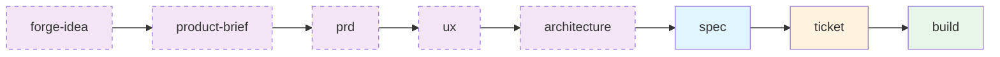

# compu-delivery-bmad-demo

## Overview

A worked example of [BMAD-METHOD](https://github.com/bmad-code-org/BMAD-METHOD), an agent-driven planning and development workflow. It takes one feature from idea → PRD → UX → architecture → stories → code → review, with a named agent running each phase and writing an artifact the next phase reads.

### TLDR: Command Flow

The BMAD planning commands are independent tools, **not stages or steps**. Run whichever ones close the gaps in your intent, in any order, then condense what they produced and hand it to `/bmad-spec`. `/bmad-spec` writes the contract; it doesn't help you discover what you want. After that, run `/bmad-build`.

```mermaid
graph LR
    subgraph P["Optional planning tools (any subset, any order)"]
        direction TB
        A["forge-idea"]
        B["brainstorming"]
        C["deep-recon"]
        D["product-brief"]
        E["prfaq"]
        F["prd"]
        G["ux"]
        H["architecture"]
    end

    P -->|"condensed intent"| S["spec"] --> T["build"]

    style P fill:#faf5fc,stroke:#8e24aa,stroke-dasharray: 5 5
    style A fill:#f3e5f5,stroke-dasharray: 5 5
    style B fill:#f3e5f5,stroke-dasharray: 5 5
    style C fill:#f3e5f5,stroke-dasharray: 5 5
    style D fill:#f3e5f5,stroke-dasharray: 5 5
    style E fill:#f3e5f5,stroke-dasharray: 5 5
    style F fill:#f3e5f5,stroke-dasharray: 5 5
    style G fill:#f3e5f5,stroke-dasharray: 5 5
    style H fill:#f3e5f5,stroke-dasharray: 5 5
    style S fill:#e1f5ff
    style T fill:#e8f5e9
```



The purple dashed box holds the optional planning tools (use any subset, in any order); `/bmad-spec` and `/bmad-build` are the required steps. The path chosen for this demo starts from a rough idea and, because the feature is epic-sized, routes the spec through `bmad-ticket` (story breakdown) before building:



See [Choose a planning path](https://docs.bmad-method.org/plan/choose-a-planning-path/#get-to-a-well-defined-intent).

## Prerequisites

Install BMAD into the repo:

```bash
npx bmad-method install
```

This scaffolds `_bmad/` (the method itself), `.claude/skills/` (the agents, rendered for Claude Code), and `_bmad-output/` (where artifacts land).

Install `uv` — the skills shell out to Python helpers and halt without it:

```bash
curl -LsSf https://astral.sh/uv/install.sh | sh
```

Agents are invoked as slash commands in Claude Code: `/bmad-prd`, `/bmad-architecture`, `/bmad-build`, and so on. (Older BMAD v4 docs describe a `.bmad-core/` folder and `@analyst`-style mentions; this repo is v6.11.0, which uses skills instead.) Check the install with:

```
/bmad-help
```

## Steps

> Commands below are run as slash commands in Claude Code (VS Code chat or the terminal).

### 1. Forge the idea (`/bmad-forge-idea`, branch 01-bmad-forge-idea)

Pressure-tests the rough idea through persona-driven interrogation until it hardens. Writes `forged-idea.md` (locked decisions, rejections, open assumptions), `forge-report.html`, and a `.memlog.md` decision trail to `_bmad-output/forge/bulk-hardware-order-system/`.

```
/bmad-forge-idea Requirements:
We need a system that accepts bulk hardware orders from enterprise clients, calculates their final net totals using pre-negotiated contract discounts, and tracks each order through its lifecycle from intake to final delivery. Clients should be able to view their order history or cancel active requests.
```

The session goal was to test whether the idea holds up (greenfield project). It ended **HARDENED**: flat per-client discount, ERP mock as read-only reference data, six lifecycle states, cancel only in `INTAKE`/`BACKORDERED`, and three dropdown personas with no auth.
